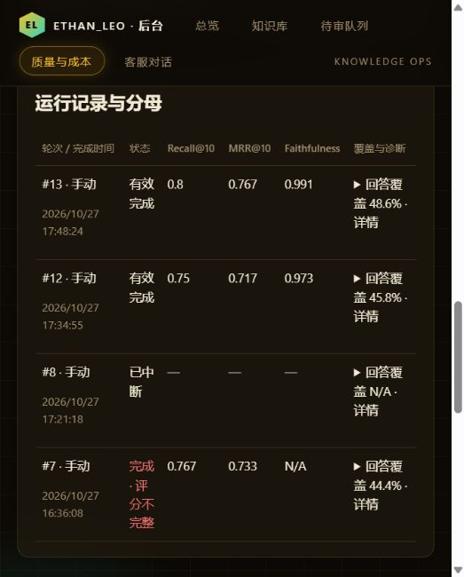
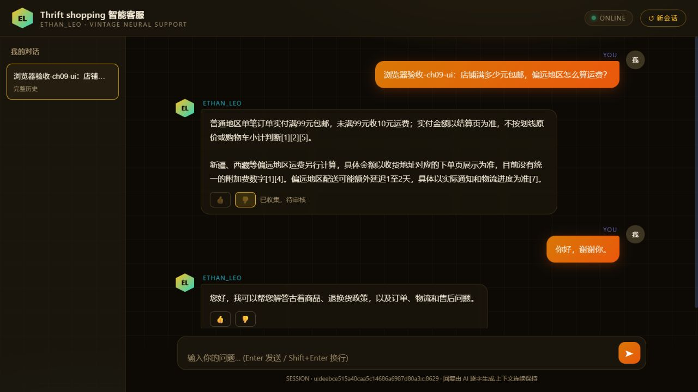

# ch09浏览器验收

本地浏览器专用通道连接8023成功；早期8024沙盒实例不可访问、Windows Chrome URL策略中止为历史失败。后续未绕过原生工具策略，改用已返回的本地浏览器DOM通道。

- 实际页面：详情原话/两入口归并/Top5全文及分数可展开；无检索显示解释；review864真实驳回后只读；review965编辑核准答案→通过待发布→96题影响预览→确认其余不变/填写审核标识→发布已生效。新会话同问正确回答“柚子罐头”并引用新知识。
- 反馈：原标签开始下一轮后点旧回答👎，事件575确为旧原话及Top5；第二标签重载同一历史再点，仍只有事件575，不重复计数，自动归并810。跨新会话/历史切换已实际操作。历史消息原先无按钮，按Vibe补用户/回答消息ID绑定及按assistant ID稳定存储键，重载后实测通过。
- 隔离故障/边界：22条分页20→2→20、状态筛选空结果；长问题/原文及script/img注入字符串均为文本，无新增注入元素/弹窗；逐题手工修订、漏填确认拦截、发布失败/维护中/原release续跑；反馈503后保持可重试，重试成功禁重复；旧无ID解释提示；无数据三卡N/A、服务错误明确提示且不归零；真实旧中断/评分不完整记录不画假0。
- 真实质量页：两轮72题三指标/有效分母和差值均可见，明确时间窗口成本“统计分页完整”，金额缺定价显示未知；窄屏实际视口538px、文档523px、单列卡483px，无横向文档溢出。临时视口覆盖已重置。
- Dashboard：专用浏览器打开日本区页面两次超时并重置；用户随后明确答复“已看到完整调用树、Prompt和Token”。该项为用户实际人工确认，非代理伪造截图；SDK真实读回另见trace-audit.md。

一次旧上下文中的合成问题被模型路由到其他，失败保留；新会话同一问题正确，本章未承诺模型质量100%。一次尝试没有碰上维护窗口，未把普通拒答计为维护验收；维护状态展示及后端租约回归另有证据。截图为本次真实合成会话，不含真实客户原话。

